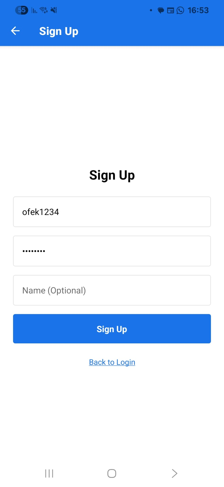
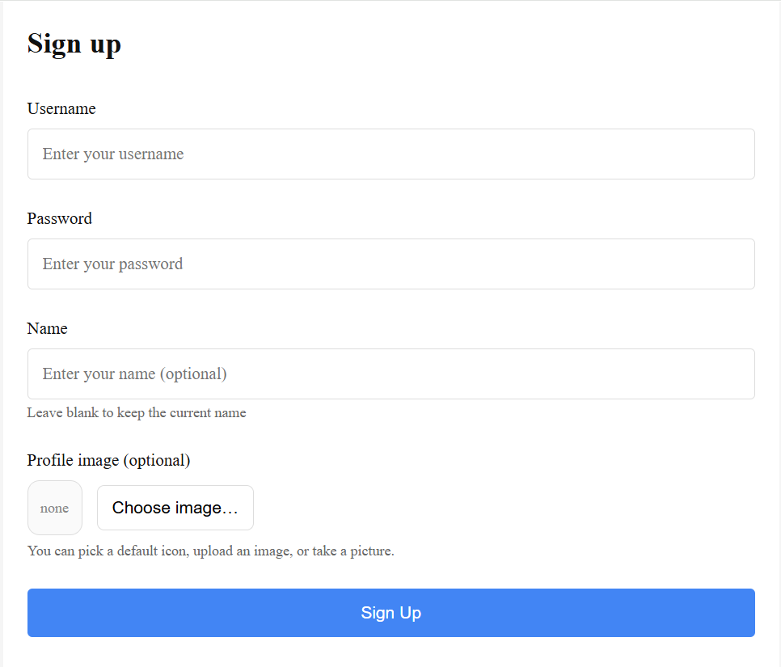
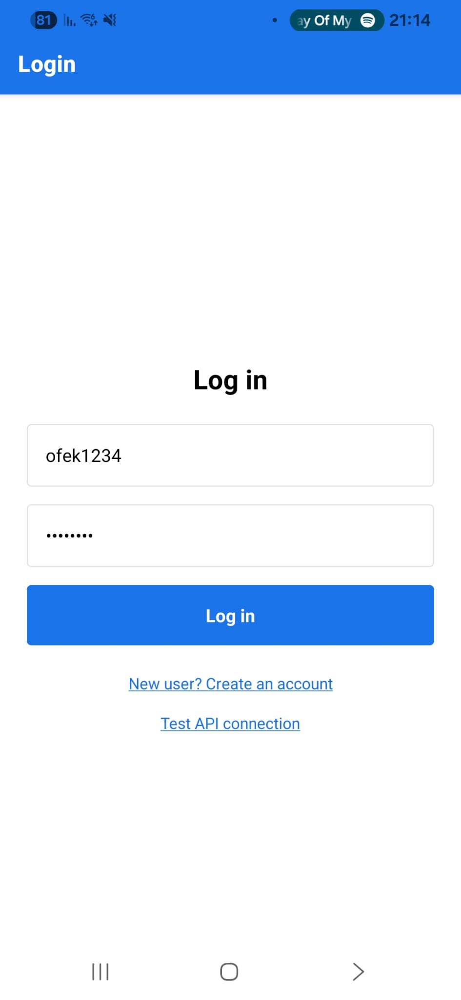
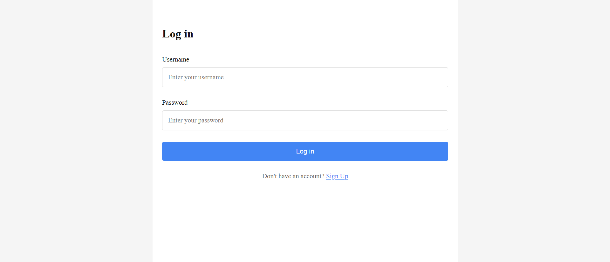
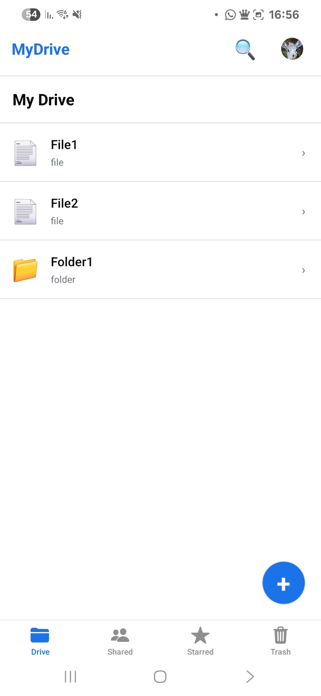
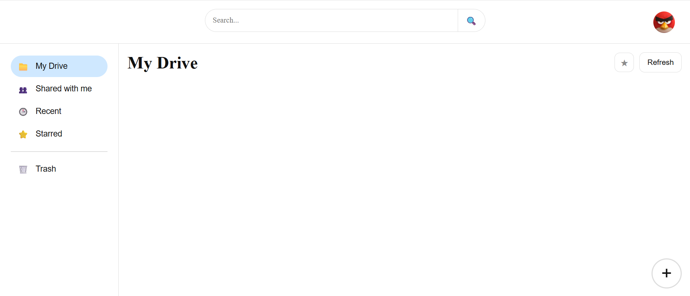

# Registration and Login Flow

This page demonstrates the user registration and login process in the system.

the **React Native client** is emphasized.
The **Web client** is shown alongside it to demonstrate that the same
authentication flow is supported across all client applications.

## User Registration

A new user registers by providing the required fields (such as username
and password). The system validates the input and provides clear feedback
in case of invalid data.

| React Native | Web Client |
|---------------------------|------------|
|  |  |

### Expected Behavior
- All required fields must be filled
- Invalid input is rejected with a clear error message
- Duplicate usernames are not allowed
- Successful registration allows the user to proceed to login

---

## User Login

After successful registration, the user logs in using valid credentials.

| React Native | Web Client |
|---------------------------|------------|
|  |  |

### Expected Behavior
- Login with correct credentials succeeds
- Login with incorrect credentials displays a clear error message
- After successful login, the user is redirected to the main application screen

---

## Authenticated Session

After logging in, the user gains access to protected areas of the application,
such as file and folder management.

| React Native | Web Client |
|---------------------------|------------|
|  |  |

If an unauthenticated user attempts to access a protected screen, the system
redirects the user to the login screen.

---

⬅️ Previous: [02 – Run the System](02-Run-The-System.md)  
➡️ Next: [04 – Client Operations](04-Client-Operations.md)  
⬅️ Back to: [Wiki Home](README.md)

