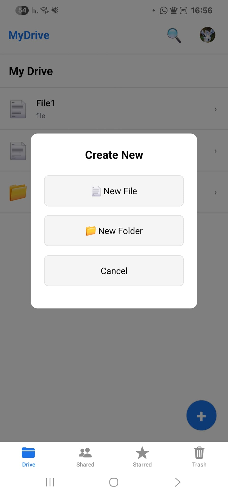
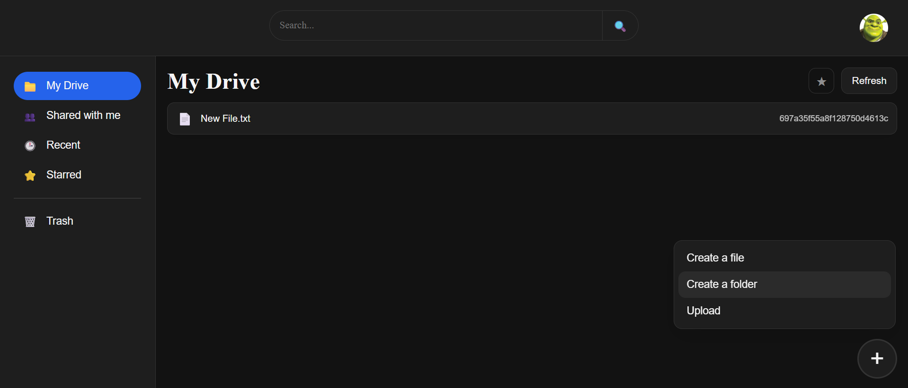
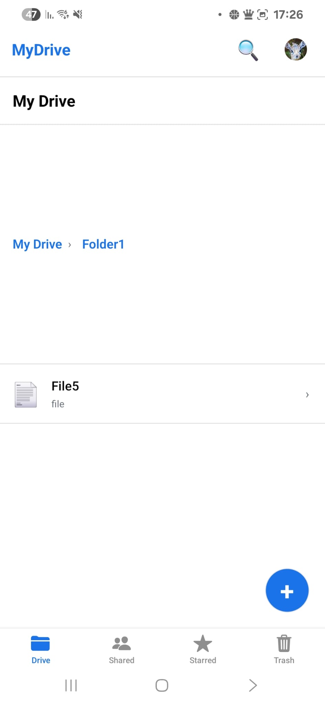
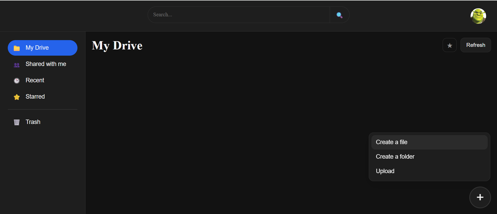
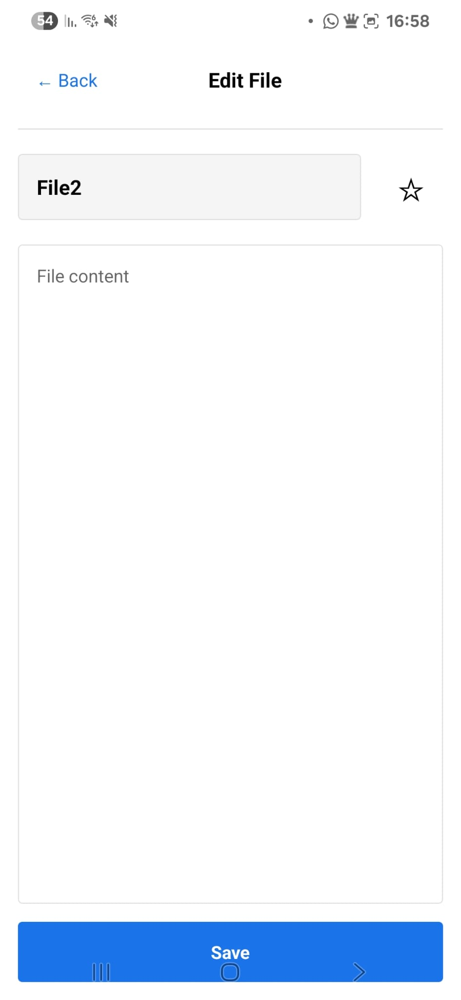
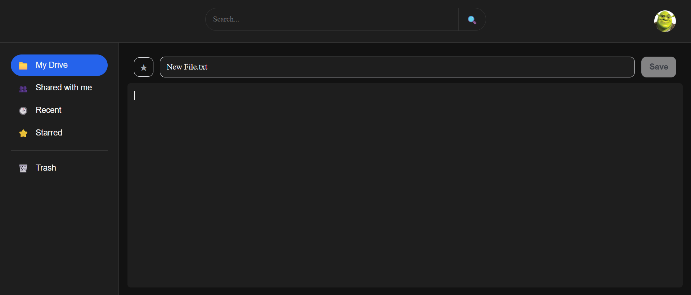
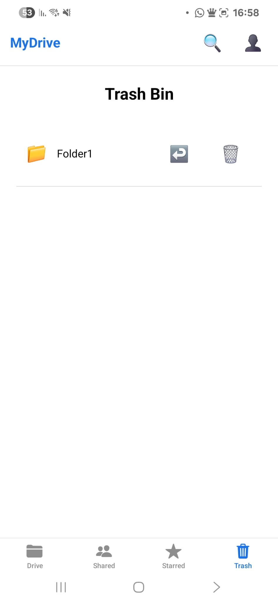
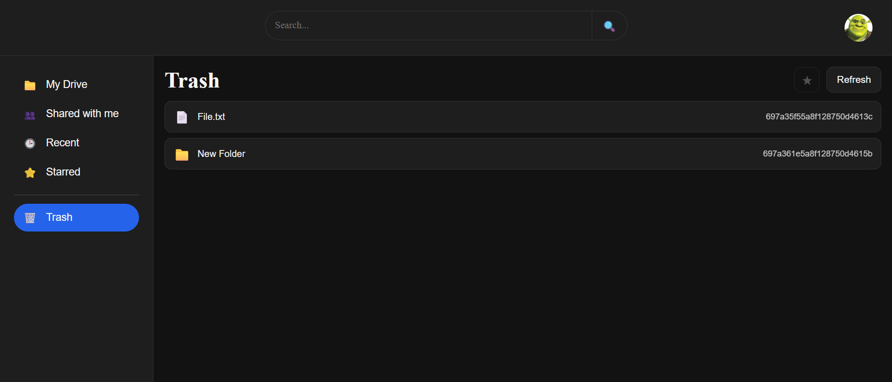
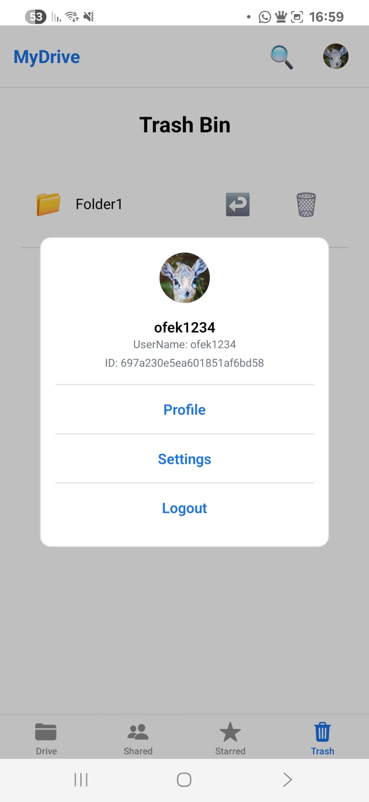
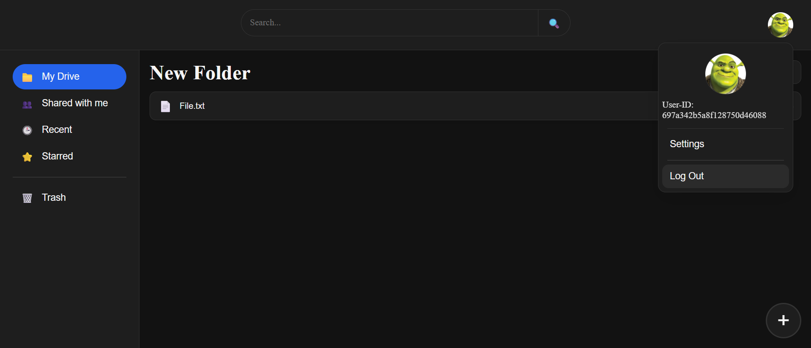

# Client File and Folder Operations

This page demonstrates file and folder operations performed by authenticated users.

the **React Native client** is emphasized.
The **Web client** is shown alongside it to demonstrate that the same
operations are supported across all client applications.

All operations shown below are performed after successful authentication.

---

## Main Screen Overview

After logging in, the user is presented with the main application screen.
This screen serves as the primary workspace for interacting with files
and folders.

| React Native | Web Client |
|---------------------------|------------|
|  |  |

### Main Screen Functionality
- Display of files and folders hierarchy
- Navigation between folders
- Access to file and folder actions (create, edit, delete)
- Access to user actions (such as logout)

---

## Create Folder

The user creates a new folder to organize files.

| React Native | Web Client |
|---------------------------|------------|
|  |  |

### Expected Behavior
- Folder is created successfully
- Folder appears immediately in the file list

---

## Create File

The user creates a new file inside an existing folder.

| React Native | Web Client |
|---------------------------|------------|
|  |  |

### Expected Behavior
- File is created successfully
- File content is saved via the File Management Server
- File appears under the selected folder

---

## Edit File

The user edits the content of an existing file and saves the changes.

| React Native | Web Client |
|---------------------------|------------|
|  |  |

### Expected Behavior
- File content is updated successfully
- Changes persist after refreshing the application

---

## Delete File / Folder

The user deletes a file or folder from the system.

| React Native | Web Client |
|---------------------------|------------|
|  | 

### Expected Behavior
- File or folder is removed successfully
- Deleted items no longer appear in the file list

---

## Logout

The user logs out of the application using the logout action available
from the main screen.

| React Native | Web Client |
|---------------------------|------------|
|  |  |

### Expected Behavior
- User session is terminated
- Authentication data is cleared
- User is redirected to the login screen
- Protected screens are no longer accessible without logging in again

---

⬅️ Previous: [03 – Registration & Login](03-Auth-Flow.md)  
⬅️ Back to: [Wiki Home](README.md)

